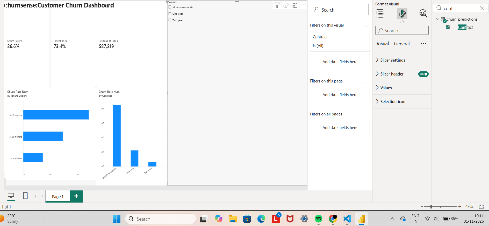

# ChurnSense: Customer Churn Prediction & Dashboard

Predicts which telecom customers are likely to churn and shows the business impact in a Power BI dashboard.

## Problem
Losing customers costs money. This project finds why customers churn, predicts who is at risk, and estimates the revenue that could be saved.

## Data
IBM Telco Customer Churn dataset: 7,043 customers, 33 columns (7,032 after cleaning).

## Approach
1. **Cleaning (Python):** fixed Total Charges, dropped 11 blank rows, removed leakage columns (Churn Value, Churn Score, CLTV, Churn Reason).
2. **EDA:** churn by contract, tenure and monthly charges.
3. **Models:** Logistic Regression, Random Forest, XGBoost (class imbalance handled with class weights).
4. **SQL:** churn rate by contract, retention by tenure bucket, revenue at risk.
5. **Power BI:** KPI cards, charts and a contract slicer.

## Results
| Model | Accuracy | Recall | F1 |
|---|---|---|---|
| Logistic Regression | 73.0% | 78.6% | 60.7% |
| Random Forest | 77.5% | 69.8% | 62.2% |
| **XGBoost (chosen)** | 74.1% | 78.9% | 61.8% |

XGBoost was chosen because catching churners (recall) matters more than overall accuracy.

## Key Findings
- Overall churn rate: **26.6%**
- Month-to-month churn **42.7%** vs One year 11.3% vs Two year 2.8%
- Retention in first 12 months is only **52.3%**, rising to 86.0% after 25+ months
- **1,196** at-risk customers, about **$87K/month** revenue at risk

## Recommendations
1. Offer discounts to move month-to-month customers to annual plans.
2. Improve onboarding and first-year offers.
3. Target the 1,196 at-risk customers with retention offers, highest churn probability first.

## Dashboard

## Files
- `churn.ipynb`: cleaning, EDA, models
- `queries.sql`: SQL queries
- `churnsense.pbix`: Power BI dashboard
- `churn_predictions.csv`: data with model predictions
- `eda_charts.png`, `dashboard.png`: charts

## Tech
Python, Pandas, Scikit-learn, XGBoost, SQL (SQLite), Power BI